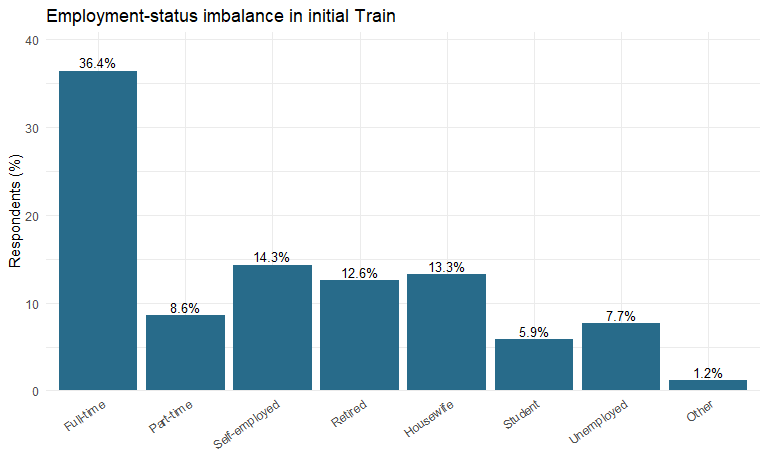
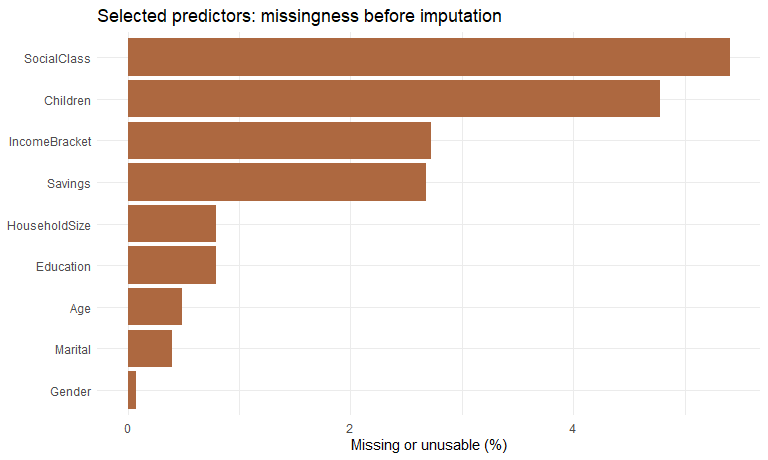
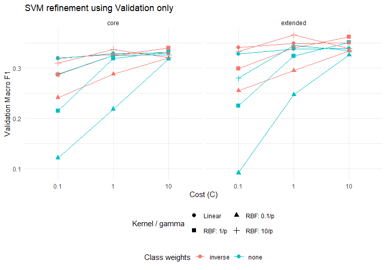
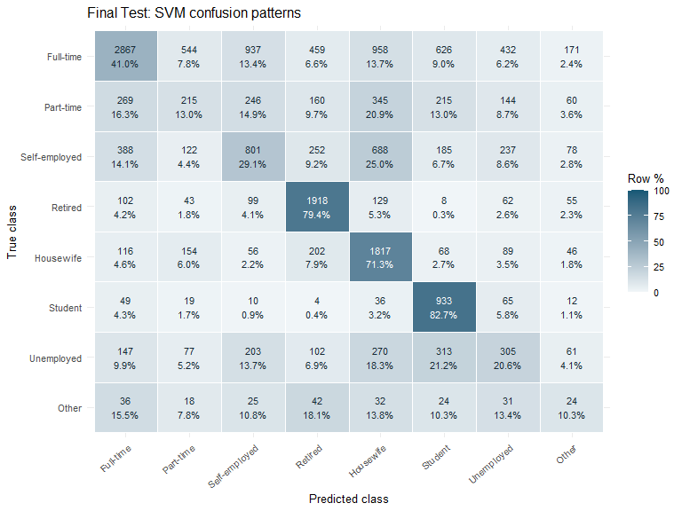
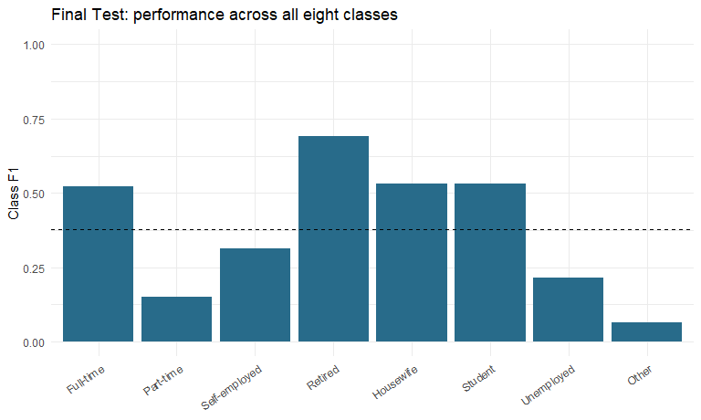

# SVM


``` r
NUMERIC_KEYS <- c(Age = "Q262", HouseholdSize = "Q270", Children = "Q274")
CATEGORY_KEYS <- list(
  Gender = as.character(1:2), Marital = as.character(1:6),
  Education = as.character(0:8), SocialClass = as.character(1:5),
  IncomeBracket = as.character(1:10), Savings = as.character(1:4),
  Income_Group = c("Low", "Lower-middle", "Upper-middle", "High", "Unclassified")
)
CATEGORY_SOURCES <- c(Gender = "Q260", Marital = "Q273", Education = "Q275",
                      SocialClass = "Q287", IncomeBracket = "Q288",
                      Savings = "Q286", Income_Group = "Income_Group")
SPECIFICATIONS <- list(
  core = c("Age", "Gender", "Marital", "Education", "SocialClass", "IncomeBracket"),
  extended = c("Age", "Gender", "Marital", "Education", "SocialClass", "IncomeBracket",
               "HouseholdSize", "Children", "Savings", "Income_Group")
)
feature_dictionary <- data.frame(
  Feature = c("Age", "Gender", "Marital", "Education", "SocialClass", "IncomeBracket",
              "HouseholdSize", "Children", "Savings", "Income_Group"),
  Source = c("Q262", "Q260", "Q273", "Q275", "Q287", "Q288", "Q270", "Q274", "Q286",
             "B_COUNTRY_ALPHA + shared crosswalk"),
  Type = c("Numeric age", rep("Categorical", 5), "Numeric/count code", "Numeric/count code",
           "Categorical", "Categorical context"),
  Included = c(rep("Core and extended", 6), rep("Extended only", 4))
)
table_out(feature_dictionary, "Table 1. Shared predictors, measurement types and feature sets.")
```


Table: Table 1. Shared predictors, measurement types and feature sets.

|Feature       |Source                             |Type                |Included          |
|:-------------|:----------------------------------|:-------------------|:-----------------|
|Age           |Q262                               |Numeric age         |Core and extended |
|Gender        |Q260                               |Categorical         |Core and extended |
|Marital       |Q273                               |Categorical         |Core and extended |
|Education     |Q275                               |Categorical         |Core and extended |
|SocialClass   |Q287                               |Categorical         |Core and extended |
|IncomeBracket |Q288                               |Categorical         |Core and extended |
|HouseholdSize |Q270                               |Numeric/count code  |Extended only     |
|Children      |Q274                               |Numeric/count code  |Extended only     |
|Savings       |Q286                               |Categorical         |Extended only     |
|Income_Group  |B_COUNTRY_ALPHA + shared crosswalk |Categorical context |Extended only     |

## Portable input and fingerprint


``` r
resolve_input <- function(filename) {
  candidates <- unique(c(file.path(document_dir, filename),
                         file.path(getwd(), filename),
                         file.path(dirname(document_dir), filename),
                         file.path(params$data_dir, filename), filename))
  hits <- candidates[file.exists(candidates)]
  if (!length(hits)) stop("Cannot find input: ", filename, ". Place it beside the Rmd; run git lfs pull.")
  p <- normalizePath(hits[1L], mustWork = TRUE)
  if (file.info(p)$size < 1000) stop("Input is too small; it may be a Git LFS pointer: ", p)
  p
}
read_selected_columns <- function(path, names_wanted) {
  names_all <- names(read.csv(path, nrows = 0, check.names = FALSE))
  missing <- setdiff(names_wanted, names_all)
  if (length(missing)) stop("Missing columns: ", paste(missing, collapse = ", "))
  types <- rep("NULL", length(names_all))
  types[match(names_wanted, names_all)] <- NA_character_
  read.csv(path, colClasses = types, check.names = FALSE,
           na.strings = c("", "NA"), stringsAsFactors = FALSE)
}
csv_path <- resolve_input(params$data_file)
csv_md5 <- unname(tools::md5sum(csv_path))
header <- names(read.csv(csv_path, nrows = 0, check.names = FALSE))
wvs <- read_selected_columns(csv_path, REQUIRED_COLUMNS)
stopifnot(nrow(wvs) >= 80L, !anyNA(wvs$Q279),
          all(as.character(wvs$Q279) %in% TARGET_LEVELS))
wvs$Outcome <- factor(as.character(wvs$Q279), levels = TARGET_LEVELS, labels = TARGET_LABELS)
cat("Input:", basename(csv_path), "\nMD5:", csv_md5,
    "\nActual rows:", nrow(wvs), "\nActual total columns:", length(header),
    "\nSelected source columns (target/country included):", length(REQUIRED_COLUMNS), "\n")
```

```
## Input: WVS_Wave7_cleaned_for_modelling.csv 
## MD5: 98bf573170f0cb6bd65a4e9a8070d4d8 
## Actual rows: 95987 
## Actual total columns: 519 
## Selected source columns (target/country included): 11
```

## Shared verified FY2021 country-income crosswalk

The map follows the frozen official FY2021 historical workbook in `source_evidence/`. TWN is High and VEN is Upper-middle. NIR explicitly inherits the UK's High group; it has no independent official row. `Unclassified` remains an unused dictionary level. The fixed FY2021 context is not survey-year-specific.


``` r
WB_GROUPS <- list(
  Low = c("ETH", "TJK"),
  `Lower-middle` = c("BGD", "BOL", "EGY", "IND", "KEN", "KGZ", "MAR", "MMR", "MNG",
                     "NGA", "NIC", "PAK", "PHL", "TUN", "UKR", "UZB", "VNM", "ZWE"),
  `Upper-middle` = c("ARG", "ARM", "BRA", "CHN", "COL", "ECU", "GTM", "IDN", "IRN",
                     "IRQ", "JOR", "KAZ", "LBN", "LBY", "MDV", "MEX", "MYS", "PER",
                     "RUS", "SRB", "THA", "TUR", "VEN"),
  High = c("AND", "AUS", "CAN", "CHL", "CYP", "CZE", "DEU", "GBR", "GRC", "HKG", "JPN",
           "KOR", "MAC", "NIR", "NLD", "NZL", "PRI", "ROU", "SGP", "SVK", "TWN", "URY",
           "USA"),
  Unclassified = character(0)
)
country_group <- setNames(rep(names(WB_GROUPS), lengths(WB_GROUPS)),
                          unlist(WB_GROUPS, use.names = FALSE))
stopifnot(!anyDuplicated(names(country_group)))
not_mapped <- setdiff(unique(as.character(wvs$B_COUNTRY_ALPHA)), names(country_group))
if (length(not_mapped)) stop("Country mapping requires team review: ", paste(not_mapped, collapse = ", "))
wvs$Income_Group <- unname(country_group[as.character(wvs$B_COUNTRY_ALPHA)])
```

# Identical stratified Train / Validation / Test split


``` r
stratified_indices <- function(y, fraction, seed) {
  set.seed(seed)
  groups <- split(seq_along(y), y, drop = TRUE)
  sort(unlist(lapply(groups, function(ii) sample(ii, floor(length(ii) * fraction))),
              use.names = FALSE))
}
train_id <- stratified_indices(wvs$Outcome, TRAIN_FRACTION, SEED)
test_id <- setdiff(seq_len(nrow(wvs)), train_id)
train <- wvs[train_id, , drop = FALSE]
test <- wvs[test_id, , drop = FALSE]
dev_id <- stratified_indices(train$Outcome, 0.75, SEED + 2)
val_id <- setdiff(seq_len(nrow(train)), dev_id)
initial_train <- train[dev_id, , drop = FALSE]
validation <- train[val_id, , drop = FALSE]
initial_original_id <- train_id[dev_id]
validation_original_id <- train_id[val_id]
stopifnot(!length(intersect(train_id, test_id)),
          !length(intersect(dev_id, val_id)),
          length(train_id) + length(test_id) == nrow(wvs),
          length(dev_id) + length(val_id) == nrow(train),
          all(table(initial_train$Outcome) > 0), all(table(validation$Outcome) > 0),
          all(table(test$Outcome) > 0))
if (nrow(wvs) == 95987L) {
  stopifnot(nrow(initial_train) == 57587L, nrow(validation) == 19199L, nrow(test) == 19201L)
}
share_table <- data.frame(Class = TARGET_LABELS,
  Train = as.integer(table(initial_train$Outcome)),
  Validation = as.integer(table(validation$Outcome)),
  Test = as.integer(table(test$Outcome)))
share_table$Train_pct <- 100 * share_table$Train / sum(share_table$Train)
share_table$Validation_pct <- 100 * share_table$Validation / sum(share_table$Validation)
share_table$Test_pct <- 100 * share_table$Test / sum(share_table$Test)
table_out(share_table, "Table 2. Identical class-stratified partitions: counts and within-partition percentages.", 2)
```


Table: Table 2. Identical class-stratified partitions: counts and within-partition percentages.

|Class         | Train| Validation| Test| Train_pct| Validation_pct| Test_pct|
|:-------------|-----:|----------:|----:|---------:|--------------:|--------:|
|Full-time     | 20981|       6994| 6994|     36.43|          36.43|    36.43|
|Part-time     |  4959|       1653| 1654|      8.61|           8.61|     8.61|
|Self-employed |  8250|       2751| 2751|     14.33|          14.33|    14.33|
|Retired       |  7247|       2416| 2416|     12.58|          12.58|    12.58|
|Housewife     |  7642|       2548| 2548|     13.27|          13.27|    13.27|
|Student       |  3382|       1128| 1128|      5.87|           5.88|     5.87|
|Unemployed    |  4431|       1477| 1478|      7.69|           7.69|     7.70|
|Other         |   695|        232|  232|      1.21|           1.21|     1.21|

``` r
partition <- rep("Test", nrow(wvs))
partition[initial_original_id] <- "Train"
partition[validation_original_id] <- "Validation"
write.csv(data.frame(CSV_row = seq_len(nrow(wvs)), Partition = partition),
          file.path(result_dir, "split_membership.csv"), row.names = FALSE)
```


``` r
class_df <- data.frame(Class = factor(TARGET_LABELS, levels = TARGET_LABELS),
                       N = as.integer(table(initial_train$Outcome)))
class_df$Percent <- 100 * class_df$N / sum(class_df$N)
ggplot2::ggplot(class_df, ggplot2::aes(Class, Percent)) +
  ggplot2::geom_col(fill = "#286B8A") +
  ggplot2::geom_text(ggplot2::aes(label = sprintf("%.1f%%", Percent)), vjust = -0.3, size = 3.4) +
  ggplot2::scale_y_continuous(expand = ggplot2::expansion(mult = c(0, 0.12))) +
  ggplot2::labs(title = "Employment-status imbalance in initial Train", x = NULL, y = "Respondents (%)") +
  ggplot2::theme_minimal(base_size = 11) +
  ggplot2::theme(axis.text.x = ggplot2::element_text(angle = 35, hjust = 1))
```

<div class="figure" style="text-align: center">

<p class="caption">Figure 1. Initial Train employment distribution; class percentages are calculated within the shared 60% partition.</p>
</div>

# Missingness evidence and train-only preprocessing


``` r
numeric_value <- function(v) {
  x <- suppressWarnings(as.numeric(as.character(v)))
  x[!is.finite(x) | x %in% c(-1, -2, -3, -4, -5, -999, -9999)] <- NA_real_
  x
}
categorical_value <- function(v, allowed) {
  x <- trimws(as.character(v))
  x[is.na(x) | !(x %in% allowed)] <- "Missing"
  x
}
missing_audit <- function(raw) {
  rows <- lapply(seq_len(nrow(feature_dictionary)), function(i) {
    nm <- feature_dictionary$Feature[i]
    if (nm == "Income_Group") return(NULL)
    source <- feature_dictionary$Source[i]
    miss <- if (nm %in% names(NUMERIC_KEYS)) is.na(numeric_value(raw[[source]])) else
      categorical_value(raw[[source]], CATEGORY_KEYS[[nm]]) == "Missing"
    data.frame(Feature = nm, Source = source, N = nrow(raw),
               Missing_N = sum(miss), Missing_pct = 100 * mean(miss))
  })
  do.call(rbind, rows)
}
```


``` r
raw_missingness <- NULL
if (nzchar(params$raw_data_file)) {
  raw_path <- resolve_input(params$raw_data_file)
  raw_header <- names(read.csv(raw_path, nrows = 0, check.names = FALSE))
  raw_selected <- read_selected_columns(raw_path, REQUIRED_COLUMNS)
  target_ok <- !is.na(raw_selected$Q279) & as.character(raw_selected$Q279) %in% TARGET_LEVELS
  table_out(data.frame(Stage = c("Raw supplied CSV", "Raw valid-target cohort"),
    Rows = c(nrow(raw_selected), sum(target_ok)),
    Total_columns = rep(length(raw_header), 2)),
    "Table 3. Supplied raw-data dimensions and target-eligibility audit.")
  raw_missingness <- missing_audit(raw_selected[target_ok, , drop = FALSE])
  table_out(raw_missingness,
    "Table 4. Pre-imputation missing/unusable responses among raw records with valid Q279.", 2)
  write.csv(raw_missingness, file.path(result_dir, "raw_selected_missingness.csv"), row.names = FALSE)
  cat("\nRaw rows excluded for invalid/missing Q279:", sum(!target_ok),
      ". These counts do not by themselves prove correspondence with the cleaned CSV.\n")
  rm(raw_selected)
} else {
  cat("**Pending evidence:** no raw CSV was supplied. Original pre-imputation missingness",
      "cannot be recovered from the cleaned input. Obtain the raw data / A1 pre-imputation",
      "summaries from the team before claiming the Messy criterion is fully evidenced.\n")
}
```


Table: Table 3. Supplied raw-data dimensions and target-eligibility audit.

|Stage                   |  Rows| Total_columns|
|:-----------------------|-----:|-------------:|
|Raw supplied CSV        | 97220|           613|
|Raw valid-target cohort | 95987|           613|


Table: Table 4. Pre-imputation missing/unusable responses among raw records with valid Q279.

|Feature       |Source |     N| Missing_N| Missing_pct|
|:-------------|:------|-----:|---------:|-----------:|
|Age           |Q262   | 95987|       470|        0.49|
|Gender        |Q260   | 95987|        71|        0.07|
|Marital       |Q273   | 95987|       379|        0.39|
|Education     |Q275   | 95987|       758|        0.79|
|SocialClass   |Q287   | 95987|      5189|        5.41|
|IncomeBracket |Q288   | 95987|      2613|        2.72|
|HouseholdSize |Q270   | 95987|       758|        0.79|
|Children      |Q274   | 95987|      4589|        4.78|
|Savings       |Q286   | 95987|      2567|        2.67|

Raw rows excluded for invalid/missing Q279: 1233 . These counts do not by themselves prove correspondence with the cleaned CSV.


``` r
if (!is.null(raw_missingness)) {
  ggplot2::ggplot(raw_missingness,
    ggplot2::aes(reorder(Feature, Missing_pct), Missing_pct)) +
    ggplot2::geom_col(fill = "#AD6840") + ggplot2::coord_flip() +
    ggplot2::labs(title = "Selected predictors: missingness before imputation",
                  x = NULL, y = "Missing or unusable (%)") + ggplot2::theme_minimal(base_size = 11)
}
```

<div class="figure" style="text-align: center">

<p class="caption">Figure 2. Optional raw-data audit: pre-imputation missing/unusable responses for selected predictors among records with valid Q279; not post-imputation NA rates.</p>
</div>

## Residual unavailable values and the SVM recipe

The next table is computed only on initial Train in the **already cleaned CSV**.
It can identify retained `Unknown` values and invalid tokens, but not earlier
mode-imputed categories. A value outside the declared categorical dictionary is
mapped to `Missing`. Neither the response nor raw country enters the model matrix.


``` r
residual_audit <- missing_audit(initial_train)
table_out(residual_audit,
  "Table 5. Residual unavailable/unusable values in cleaned initial Train; not original missingness.", 2)
```


Table: Table 5. Residual unavailable/unusable values in cleaned initial Train; not original missingness.

|Feature       |Source |     N| Missing_N| Missing_pct|
|:-------------|:------|-----:|---------:|-----------:|
|Age           |Q262   | 57587|       267|        0.46|
|Gender        |Q260   | 57587|         0|        0.00|
|Marital       |Q273   | 57587|         0|        0.00|
|Education     |Q275   | 57587|         0|        0.00|
|SocialClass   |Q287   | 57587|         0|        0.00|
|IncomeBracket |Q288   | 57587|         0|        0.00|
|HouseholdSize |Q270   | 57587|       442|        0.77|
|Children      |Q274   | 57587|      2736|        4.75|
|Savings       |Q286   | 57587|         0|        0.00|

For each feature set, numeric medians, means and standard deviations are learned
only from the candidate-fitting subset of initial Train. Numeric missingness flags
are added. Fixed codebook-compatible categorical dictionaries produce **full
one-hot encoding**, preserving category distinctions without ordinal distances.
Binary columns remain 0/1; only numeric values are z-standardised. Constant matrix
columns are dropped using fitting data only. Validation uses exactly that recipe
and column ordering. The final recipe is learned again from the complete 80% pool.
`scale = FALSE` prevents a second, implicit e1071 scaling step.


``` r
build_matrix <- function(raw, recipe) {
  blocks <- list()
  for (nm in recipe$numeric) {
    x <- numeric_value(raw[[NUMERIC_KEYS[[nm]]]])
    missing <- is.na(x)
    x[missing] <- recipe$median[[nm]]
    blocks[[nm]] <- (x - recipe$mean[[nm]]) / recipe$sd[[nm]]
    blocks[[paste0(nm, "_missing")]] <- as.integer(missing)
  }
  for (nm in recipe$categorical) {
    v <- categorical_value(raw[[CATEGORY_SOURCES[[nm]]]], CATEGORY_KEYS[[nm]])
    lv <- c(CATEGORY_KEYS[[nm]], "Missing")
    for (j in seq_along(lv)) blocks[[paste0(nm, "__", j)]] <- as.integer(v == lv[j])
  }
  x <- do.call(cbind, blocks)
  storage.mode(x) <- "double"
  if (!is.null(recipe$keep)) x <- x[, recipe$keep, drop = FALSE]
  stopifnot(nrow(x) == nrow(raw), all(is.finite(x)))
  x
}
learn_recipe <- function(raw, spec) {
  features <- SPECIFICATIONS[[spec]]
  if (is.null(features)) stop("Unknown feature specification")
  num <- intersect(features, names(NUMERIC_KEYS))
  cat <- intersect(features, names(CATEGORY_KEYS))
  values <- setNames(lapply(num, function(nm) numeric_value(raw[[NUMERIC_KEYS[[nm]]]])), num)
  if (any(vapply(values, function(x) all(is.na(x)), logical(1)))) {
    stop("A numeric feature is entirely unavailable in the fitting partition; review the shared input.")
  }
  med <- vapply(values, stats::median, numeric(1), na.rm = TRUE)
  filled <- Map(function(x, m) { x[is.na(x)] <- m; x }, values, med)
  mu <- vapply(filled, mean, numeric(1))
  sigma <- vapply(filled, stats::sd, numeric(1))
  sigma[!is.finite(sigma) | sigma == 0] <- 1
  recipe <- list(spec = spec, numeric = num, categorical = cat,
                 median = med, mean = mu, sd = sigma, keep = NULL)
  x <- build_matrix(raw, recipe)
  variable <- apply(x, 2, function(z) length(unique(z)) > 1L)
  recipe$keep <- colnames(x)[variable]
  recipe$removed <- colnames(x)[!variable]
  recipe$encoded_before <- ncol(x)
  if (!length(recipe$keep)) stop("No varying predictor columns")
  recipe
}
```

# SVM design and validation-only refinement

A linear kernel provides a simpler decision-boundary reference; the RBF kernel
can represent nonlinear combinations of the same inputs. `e1071` uses LIBSVM
one-against-one voting, giving 28 binary classifiers for eight outcome classes
(Chang & Lin, 2011). We fit `C-classification`, not regression. We do not estimate
probabilities because the required F1/accuracy evaluation uses class predictions.

Both core and extended sets receive the **same 24 hyperparameter candidates**:
three costs (`0.1, 1, 10`), linear or radial kernel, and no weights or inverse
training-frequency weights. RBF has three gamma factors (`0.1, 1, 10`) divided
by the encoded fitting dimension. There are 48 candidates in total. These ranges
are a modest, predefined search, not a claim of exhaustive optimisation.
Class weights are `N / (8 * n_k)` computed from the actual fitting labels, with
named classes; Validation/Test prevalence does not determine weights.

The shared 60% training partition is retained intact. If it exceeds `tuning_cap`,
a fixed class-stratified subset is selected using seed 5006, for both feature
sets and all candidates. Floor rounding can make its size slightly below the cap.
Validation always uses the complete shared 20%. The cap reduces runtime but may
change candidate rankings relative to training each candidate on all 60%.

## Exactly the baseline's eight-class metrics


``` r
evaluate_8class <- function(truth, pred, show_confusion = TRUE) {
  tr <- factor(as.character(truth), levels = TARGET_LABELS)
  pr <- factor(as.character(pred), levels = TARGET_LABELS)
  if (anyNA(tr) || anyNA(pr)) stop("Unknown/missing prediction class")
  cm <- table(True = tr, Predicted = pr)
  tp <- diag(cm)
  support <- rowSums(cm)
  predicted <- colSums(cm)
  precision <- ifelse(predicted > 0, tp / predicted, 0)
  recall <- ifelse(support > 0, tp / support, 0)
  f1 <- ifelse(precision + recall > 0,
               2 * precision * recall / (precision + recall), 0)
  by_class <- data.frame(Class = TARGET_LABELS, Support = as.integer(support),
                         Precision = round(precision, 4), Recall = round(recall, 4),
                         F1 = round(f1, 4), row.names = NULL)
  overall <- data.frame(Macro_F1 = mean(f1),
                        Weighted_F1 = sum(support * f1) / sum(support),
                        Accuracy = sum(tp) / sum(cm))
  if (show_confusion) print(cm)
  list(overall = overall, by_class = by_class, confusion = cm)
}
```


``` r
make_grid <- function(p) {
  linear <- expand.grid(Kernel = "linear", Cost = c(0.1, 1, 10),
    Gamma_factor = NA_real_, Weight = c("none", "inverse"), stringsAsFactors = FALSE)
  radial <- expand.grid(Kernel = "radial", Cost = c(0.1, 1, 10),
    Gamma_factor = c(0.1, 1, 10), Weight = c("none", "inverse"), stringsAsFactors = FALSE)
  out <- rbind(linear, radial)
  out$Gamma <- ifelse(out$Kernel == "radial", out$Gamma_factor / p, NA_real_)
  out
}
class_weights <- function(y, mode) {
  if (mode == "none") return(NULL)
  counts <- table(factor(as.character(y), levels = TARGET_LABELS))
  if (any(counts == 0)) stop("Every fitting class must be represented")
  setNames(length(y) / (length(TARGET_LABELS) * as.numeric(counts)), TARGET_LABELS)
}
fit_svm <- function(x, y, candidate) {
  args <- list(x = x, y = factor(as.character(y), levels = TARGET_LABELS),
    type = "C-classification", kernel = candidate$Kernel[[1]],
    cost = candidate$Cost[[1]], scale = FALSE, probability = FALSE,
    class.weights = class_weights(y, candidate$Weight[[1]]),
    cachesize = 256, tolerance = 0.001, na.action = stats::na.fail)
  if (candidate$Kernel[[1]] == "radial") args$gamma <- candidate$Gamma[[1]]
  do.call(e1071::svm, args)
}
rank_candidates <- function(x) {
  x[order(-x$Macro_F1, -x$Weighted_F1,
    match(x$Spec, names(SPECIFICATIONS)), match(x$Kernel, c("linear", "radial")),
    match(x$Weight, c("none", "inverse")), x$Cost,
    ifelse(is.na(x$Gamma), 0, x$Gamma)), , drop = FALSE]
}
```


``` r
fit_id <- seq_len(nrow(initial_train))
if (length(fit_id) > DEV_CAP) {
  fit_id <- stratified_indices(initial_train$Outcome, DEV_CAP / length(fit_id), SEED + 3)
}
development <- initial_train[fit_id, , drop = FALSE]
stopifnot(all(table(development$Outcome) > 0))
write.csv(data.frame(CSV_row = initial_original_id[fit_id]),
          file.path(result_dir, "candidate_fit_rows.csv"), row.names = FALSE)
recipe_by_spec <- lapply(names(SPECIFICATIONS), function(s) learn_recipe(development, s))
names(recipe_by_spec) <- names(SPECIFICATIONS)
dimension_table <- do.call(rbind, lapply(names(SPECIFICATIONS), function(s) {
  r <- recipe_by_spec[[s]]
  data.frame(Spec = s, Original_predictors = length(SPECIFICATIONS[[s]]),
    Encoded_before_constant_removal = r$encoded_before,
    Encoded_used = length(r$keep), Fit_N = nrow(development), Validation_N = nrow(validation))
}))
table_out(dimension_table, "Table 6. Raw predictor counts versus encoded SVM dimensions and actual fitting sizes.")
```


Table: Table 6. Raw predictor counts versus encoded SVM dimensions and actual fitting sizes.

|Spec     | Original_predictors| Encoded_before_constant_removal| Encoded_used| Fit_N| Validation_N|
|:--------|-------------------:|-------------------------------:|------------:|-----:|------------:|
|core     |                   6|                              39|           34|  9997|        19199|
|extended |                  10|                              54|           46|  9997|        19199|

``` r
grids <- lapply(recipe_by_spec, function(r) make_grid(length(r$keep)))
# Include code bodies and the data/RNG/package contract so stale caches are not silently reused.
signature <- list(Version = EXPERIMENT_VERSION, CSV_MD5 = csv_md5,
  RNG = RNGkind(), R_version = as.character(getRversion()),
  E1071 = as.character(utils::packageVersion("e1071")),
  Seed = SEED, Train_ID = train_id, Test_ID = test_id, Dev_ID = dev_id, Val_ID = val_id,
  Fit_ID = fit_id, Features = SPECIFICATIONS, Numeric = NUMERIC_KEYS,
  Categories = CATEGORY_KEYS, Category_sources = CATEGORY_SOURCES, Map = WB_GROUPS,
  Grids = grids, Functions = lapply(c("stratified_indices", "numeric_value", "categorical_value",
    "build_matrix", "learn_recipe", "evaluate_8class", "make_grid", "class_weights",
    "fit_svm", "rank_candidates"), function(nm) paste(deparse(get(nm)), collapse = "\n")))
validation_cache <- file.path(result_dir, "validation_cache.rds")
cached <- if (file.exists(validation_cache)) readRDS(validation_cache) else NULL
if (!is.null(cached) && identical(cached$signature, signature) && all(cached$ranking$Status == "ok")) {
  ranking <- cached$ranking
  cat("Validation: matching cached experiment reused.\n\n")
} else {
  rows <- list()
  for (s in names(SPECIFICATIONS)) {
    x_fit <- build_matrix(development, recipe_by_spec[[s]])
    x_val <- build_matrix(validation, recipe_by_spec[[s]])
    grid <- grids[[s]]
    for (i in seq_len(nrow(grid))) {
      candidate <- grid[i, , drop = FALSE]
      notices <- character()
      start <- proc.time()[["elapsed"]]
      attempt <- tryCatch(withCallingHandlers({
        model <- fit_svm(x_fit, development$Outcome, candidate)
        fitted_at <- proc.time()[["elapsed"]]
        pred <- predict(model, x_val)
        prediction_at <- proc.time()[["elapsed"]]
        met <- evaluate_8class(validation$Outcome, pred, FALSE)
        list(met = met, fit_seconds = fitted_at - start,
             predict_seconds = prediction_at - fitted_at, nSV = sum(model$nSV))
      }, warning = function(w) {
        notices <<- c(notices, conditionMessage(w))
        invokeRestart("muffleWarning")
      }), error = function(e) list(error = conditionMessage(e)))
      ok <- is.null(attempt$error)
      rows[[length(rows) + 1L]] <- data.frame(Spec = s, candidate,
        Fit_N = nrow(development), Validation_N = nrow(validation), P = ncol(x_fit),
        Macro_F1 = if (ok) attempt$met$overall$Macro_F1 else NA_real_,
        Weighted_F1 = if (ok) attempt$met$overall$Weighted_F1 else NA_real_,
        Accuracy = if (ok) attempt$met$overall$Accuracy else NA_real_,
        Fit_seconds = if (ok) attempt$fit_seconds else proc.time()[["elapsed"]] - start,
        Predict_seconds = if (ok) attempt$predict_seconds else NA_real_,
        Support_vectors = if (ok) attempt$nSV else NA_integer_,
        Status = if (!ok) "error" else if (length(notices)) "warning" else "ok",
        Notes = if (!ok) attempt$error else paste(unique(notices), collapse = " | "),
        stringsAsFactors = FALSE)
    }
  }
  ranking <- do.call(rbind, rows)
  saveRDS(list(signature = signature, ranking = ranking), validation_cache)
}
write.csv(ranking, file.path(result_dir, "validation_candidates.csv"), row.names = FALSE)
eligible <- ranking[ranking$Status == "ok" & is.finite(ranking$Macro_F1), , drop = FALSE]
if (!all(names(SPECIFICATIONS) %in% eligible$Spec)) {
  stop("A feature set has no clean successful candidate. Inspect validation_candidates.csv.")
}
eligible <- rank_candidates(eligible)
best_by_spec <- do.call(rbind, lapply(names(SPECIFICATIONS), function(s) {
  eligible[eligible$Spec == s, , drop = FALSE][1L, , drop = FALSE]
}))
winner <- eligible[1L, , drop = FALSE]
table_out(best_by_spec[, c("Spec", "Kernel", "Cost", "Gamma", "Weight", "Macro_F1",
                           "Weighted_F1", "Accuracy", "Fit_seconds", "Support_vectors")],
  "Table 7. Best clean Validation candidate within each feature set; no Test scores used.")
```


Table: Table 7. Best clean Validation candidate within each feature set; no Test scores used.

|Spec     |Kernel | Cost|  Gamma|Weight  | Macro_F1| Weighted_F1| Accuracy| Fit_seconds| Support_vectors|
|:--------|:------|----:|------:|:-------|--------:|-----------:|--------:|-----------:|---------------:|
|core     |radial |   10| 0.0294|inverse |   0.3399|      0.4063|   0.4179|       15.19|            8752|
|extended |radial |    1| 0.2174|inverse |   0.3652|      0.4408|   0.4510|       18.21|            9123|

``` r
cat("\nValidation-selected overall configuration:", winner$Spec, "/", winner$Kernel,
    "; cost =", winner$Cost, "; gamma =", winner$Gamma, "; weights =", winner$Weight, ".\n\n")
```


Validation-selected overall configuration: extended / radial ; cost = 1 ; gamma = 0.2173913 ; weights = inverse .

``` r
if (any(ranking$Status != "ok")) {
  table_out(ranking[ranking$Status != "ok", c("Spec", "Kernel", "Cost", "Gamma", "Status", "Notes")],
    "Table 8. Candidates requiring investigation before final evaluation.")
}
write.csv(best_by_spec, file.path(result_dir, "validation_best_by_spec.csv"), row.names = FALSE)
write.csv(winner, file.path(result_dir, "selected_configuration.csv"), row.names = FALSE)
```


``` r
plot_validation <- eligible
plot_validation$Cost_label <- factor(plot_validation$Cost, levels = c(0.1, 1, 10))
plot_validation$Gamma_label <- ifelse(plot_validation$Kernel == "linear", "Linear",
  paste0("RBF: ", plot_validation$Gamma_factor, "/p"))
ggplot2::ggplot(plot_validation,
  ggplot2::aes(Cost_label, Macro_F1, colour = Weight, shape = Gamma_label,
               group = interaction(Weight, Gamma_label))) +
  ggplot2::geom_point(size = 2.5) + ggplot2::geom_line() + ggplot2::facet_wrap(~Spec) +
  ggplot2::labs(title = "SVM refinement using Validation only", x = "Cost (C)",
                y = "Validation Macro F1", colour = "Class weights", shape = "Kernel / gamma") +
  ggplot2::guides(shape = ggplot2::guide_legend(nrow = 2, byrow = TRUE, order = 1),
                  colour = ggplot2::guide_legend(nrow = 1, order = 2)) +
  ggplot2::theme_minimal(base_size = 11) +
  ggplot2::theme(legend.position = "bottom", legend.box = "vertical")
```

<div class="figure" style="text-align: center">

<p class="caption">Figure 3. Candidate Validation Macro F1 by shared feature set; only clean successful fits are plotted. Test data do not determine rankings.</p>
</div>


``` r
final_record <- NULL
final_path <- file.path(result_dir, "final_evaluation.rds")
if (!isTRUE(params$run_final)) {
  cat("**Final Test pending.** Set `run_final: true` only after finishing Validation refinement.",
      "No Test predictions or Test performance have been computed by this run.\n")
} else {
  if (any(ranking$Status != "ok")) stop("Resolve all failed/warning candidates before final evaluation.")
  if (file.exists(final_path)) {
    prior <- readRDS(final_path)
    if (!identical(prior$signature, signature) || !identical(prior$winner, winner)) {
      stop("A different final-test experiment already exists in this output directory. Do not tune against it. ",
           "Document the methodological reason for any reanalysis and retain the prior record separately.")
    }
    final_record <- prior
    cat("Matching final evaluation reused; Test was not rescored.\n\n")
  } else {
    recipe_final <- learn_recipe(train, winner$Spec[[1]])
    x_train <- build_matrix(train, recipe_final)
    x_test <- build_matrix(test, recipe_final)
    start <- proc.time()[["elapsed"]]
    final_fit <- withCallingHandlers(fit_svm(x_train, train$Outcome, winner),
      warning = function(w) stop("Final refit warning; investigate before scoring Test: ", conditionMessage(w)))
    fit_seconds <- proc.time()[["elapsed"]] - start
    start_predict <- proc.time()[["elapsed"]]
    final_prediction <- predict(final_fit, x_test)
    predict_seconds <- proc.time()[["elapsed"]] - start_predict
    final_metrics <- evaluate_8class(test$Outcome, final_prediction, FALSE)
    # The reference rules use only the complete 80% pool's labels/proportions.
    majority <- names(which.max(table(train$Outcome)))
    majority_eval <- evaluate_8class(test$Outcome, rep(majority, nrow(test)), FALSE)
    set.seed(SEED + 1)
    pred_chance <- sample(TARGET_LABELS, nrow(test), replace = TRUE,
      prob = as.numeric(prop.table(table(train$Outcome))))
    chance_eval <- evaluate_8class(test$Outcome, pred_chance, FALSE)
    comparison <- rbind(data.frame(Model = "Training-majority", majority_eval$overall),
      data.frame(Model = "Training-prior chance (one draw)", chance_eval$overall),
      data.frame(Model = paste("SVM", winner$Spec, winner$Kernel), final_metrics$overall))
    final_record <- list(signature = signature, winner = winner, Recipe = recipe_final,
      Model = final_fit, Metrics = final_metrics, Comparison = comparison,
      Predictions = data.frame(CSV_row = test_id, True = test$Outcome, Predicted = final_prediction),
      Train_N = nrow(train), Test_N = nrow(test), P = ncol(x_train),
      Fit_seconds = fit_seconds, Predict_seconds = predict_seconds,
      Evaluated_at = format(Sys.time(), tz = "UTC", usetz = TRUE),
      Session = utils::sessionInfo())
    saveRDS(final_record, final_path)
  }
  table_out(final_record$Comparison, "Table 9. Single final held-out evaluation and shared trivial references.")
  table_out(final_record$Metrics$by_class, "Table 10. Final Test support, precision, recall and F1 for all eight classes.")
  table_out(data.frame(Train_N = final_record$Train_N, Test_N = final_record$Test_N,
    Encoded_P = final_record$P, Support_vectors = sum(final_record$Model$nSV),
    Fit_seconds = final_record$Fit_seconds, Predict_seconds = final_record$Predict_seconds),
    "Table 11. Complete 80% refit size, model size and measured computational cost.")
  write.csv(final_record$Comparison, file.path(result_dir, "test_comparison.csv"), row.names = FALSE)
  write.csv(final_record$Metrics$by_class, file.path(result_dir, "test_by_class.csv"), row.names = FALSE)
  write.csv(as.matrix(final_record$Metrics$confusion), file.path(result_dir, "test_confusion.csv"))
  write.csv(final_record$Predictions, file.path(result_dir, "test_predictions.csv"), row.names = FALSE)
}
```


Table: Table 9. Single final held-out evaluation and shared trivial references.

|Model                            | Macro_F1| Weighted_F1| Accuracy|
|:--------------------------------|--------:|-----------:|--------:|
|Training-majority                |   0.0667|      0.1945|   0.3643|
|Training-prior chance (one draw) |   0.1294|      0.2090|   0.2091|
|SVM extended radial              |   0.3778|      0.4544|   0.4625|


Table: Table 10. Final Test support, precision, recall and F1 for all eight classes.

|Class         | Support| Precision| Recall|     F1|
|:-------------|-------:|---------:|------:|------:|
|Full-time     |    6994|    0.7214| 0.4099| 0.5228|
|Part-time     |    1654|    0.1804| 0.1300| 0.1511|
|Self-employed |    2751|    0.3370| 0.2912| 0.3124|
|Retired       |    2416|    0.6110| 0.7939| 0.6905|
|Housewife     |    2548|    0.4250| 0.7131| 0.5326|
|Student       |    1128|    0.3933| 0.8271| 0.5331|
|Unemployed    |    1478|    0.2234| 0.2064| 0.2146|
|Other         |     232|    0.0473| 0.1034| 0.0650|


Table: Table 11. Complete 80% refit size, model size and measured computational cost.

| Train_N| Test_N| Encoded_P| Support_vectors| Fit_seconds| Predict_seconds|
|-------:|------:|---------:|---------------:|-----------:|---------------:|
|   76786|  19201|        46|           67060|     1699.47|            94.8|


``` r
if (!is.null(final_record)) {
  cm <- final_record$Metrics$confusion
  cm_df <- as.data.frame(cm)
  row_pct <- sweep(as.matrix(cm), 1, rowSums(cm), "/")
  cm_df$Percent <- 100 * as.vector(row_pct)
  cm_df$True <- factor(cm_df$True, levels = rev(TARGET_LABELS))
  cm_df$Predicted <- factor(cm_df$Predicted, levels = TARGET_LABELS)
  cm_df$Label <- sprintf("%d\n%.1f%%", cm_df$Freq, cm_df$Percent)
  ggplot2::ggplot(cm_df, ggplot2::aes(Predicted, True, fill = Percent)) +
    ggplot2::geom_tile(colour = "white") +
    ggplot2::geom_text(ggplot2::aes(label = Label, colour = Percent > 55), size = 2.9) +
    ggplot2::scale_colour_manual(values = c("FALSE" = "#182B38", "TRUE" = "white"), guide = "none") +
    ggplot2::scale_fill_gradient(low = "#F1F6F8", high = "#165976", limits = c(0, 100)) +
    ggplot2::labs(title = "Final Test: SVM confusion patterns", x = "Predicted class", y = "True class",
                  fill = "Row %") + ggplot2::theme_minimal(base_size = 10) +
    ggplot2::theme(axis.text.x = ggplot2::element_text(angle = 40, hjust = 1))
}
```

<div class="figure" style="text-align: center">

<p class="caption">Figure 4. Final SVM Test confusion matrix, normalised within each true-class row; cells display counts and row percentages. Rows are actual classes and columns are predictions.</p>
</div>


``` r
if (!is.null(final_record)) {
  pc <- final_record$Metrics$by_class
  pc$Class <- factor(pc$Class, levels = TARGET_LABELS)
  ggplot2::ggplot(pc, ggplot2::aes(Class, F1)) +
    ggplot2::geom_col(fill = "#286B8A") +
    ggplot2::geom_hline(yintercept = final_record$Metrics$overall$Macro_F1, linetype = 2) +
    ggplot2::coord_cartesian(ylim = c(0, 1)) +
    ggplot2::labs(title = "Final Test: performance across all eight classes", x = NULL, y = "Class F1") +
    ggplot2::theme_minimal(base_size = 11) +
    ggplot2::theme(axis.text.x = ggplot2::element_text(angle = 35, hjust = 1))
}
```

<div class="figure" style="text-align: center">

<p class="caption">Figure 5. Final SVM Test F1 for every employment class, including zero scores; the dashed line is final Macro F1.</p>
</div>


# Legacy pre-correction SVM discussion and limitations

> **Legacy results, not the FY2021-corrected rerun:** the fixed configuration and numerical claims below belong to the original mapping. They are retained for provenance only. Corrected results must come from this run's generated validation and Test tables; do not reuse these old figures.

Validation selected the extended-feature RBF SVM with C = 1,
gamma = 0.212766 and inverse-frequency class weights. After refitting
on the complete development set, Test Macro F1 was 0.3801,
Weighted F1 was 0.4570 and accuracy was 46.47%.

Performance varied substantially across classes. Retired had the
highest F1 (0.6927), while Other (0.0627), Part-time (0.1679) and
Unemployed (0.2150) remained difficult to classify. The model
therefore provides limited discrimination for several employment
categories despite outperforming the majority-class reference.

Hyperparameters were selected using one fixed validation set and
9,997 training records, so the selected configuration may depend on
the split and fitting subset. The analysis also inherits the
preprocessing and country-income mapping limitations documented
in baseline.Rmd.


# References

Chang, C.-C., & Lin, C.-J. (2011). LIBSVM: A library for support
vector machines. *ACM Transactions on Intelligent Systems and
Technology, 2*(3), Article 27.
https://doi.org/10.1145/1961189.1961199
